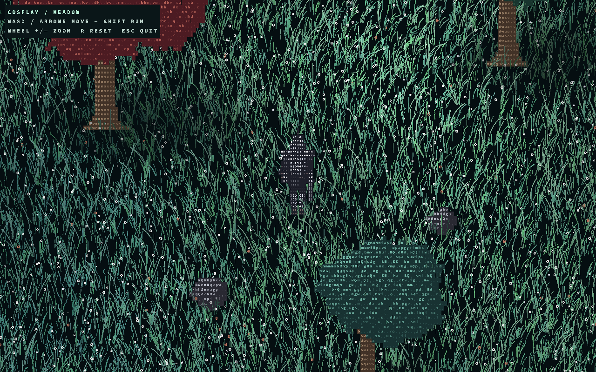
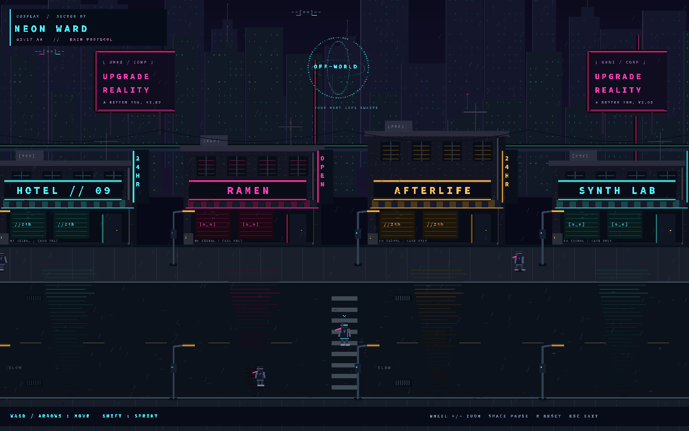

# CosPlay Rust — native glyph meadow

The main graphical demo is a **2D top-down world with a real animated 3D knight
rendered as glyphs**, following the supplied `ascii-demo.zip` reference. This is
not a terminal approximation or a fullscreen ASCII post-processing filter.

The original Scala engine remains unchanged. This Rust implementation is not
source-compatible with Scala. It targets functional parity: see
[`PARITY.md`](PARITY.md) for the measured **82%** engine-feature assessment and
the remaining content/tooling gaps.



*Native Metal capture, seed 2024, initial frame, 1280×800.*

## Explore Neon Ward

A playable cyberpunk street built with the existing **native spatial glyph
renderer**: parallax skylines, neon storefronts, wet-asphalt reflections, rain,
rooftop drones, a passing maglev, and walking pedestrians. The articulated
glyph-art runner has a neon visor and scarf; no external art assets are needed.

```sh
cargo run --release --features spatial --bin cyberpunk
```



**WASD / arrows** move in both street directions and into alleys, **Shift**
sprints, **wheel / +/-** zoom, **Space** pauses, **R** resets, **F1** toggles
auto-walking, and **Esc** exits. Storefronts and lamp posts block movement;
the camera follows the runner. This is an exploration scene, not a combat game.

Reproducible capture (requires a GPU, not a display):

```sh
cargo run --release --features spatial --bin cyberpunk -- \
  --headless --frames 120 --size 1280x800 --output /tmp/cyberpunk.png
```

Use `--auto` for automatic movement, `--seed N` for seeded surface/rain details,
or `--frames 0` for the initial scene. `--help` lists all options. The scene and
collision tests run without a GPU: `cargo test --features spatial cyberpunk`.

## Play the meadow

Install current stable Rust, then from the repository root:

```sh
cargo run --release --features meadow --bin meadow
```

This opens a native GPU window (Metal / Vulkan / DirectX, depending on platform).
Use **release mode** for interactive performance. No JVM, Node.js, browser, or
reference ZIP is needed at runtime.

| Control | Action |
|---|---|
| WASD / arrow keys | Move |
| Shift | Run |
| Mouse wheel / + / - | Zoom |
| Space | Pause / resume |
| R | Reset the seeded world |
| F1 | Toggle automatic walking |
| Esc | Quit |

It is an exploration/visual demo, not a finished RPG: combat, quests, networking,
and persistence are not implemented.

### Scene and rendering

- Dense procedural teal/sage grass with curved blades, rolling gusts, tip sheen,
  and displacement around the player.
- Flowers, green/red/teal trees, rocks, simulated moonlight and soft blob shadows.
- Ground-position depth ordering: foreground grass occludes the knight's legs;
  tree/rock backings hide the foliage behind them.
- Smooth movement, turning, camera follow, held-key input, running, and trunk/rock
  collision. The world is bounded; the grass tile wraps around the camera.
- Actual low-poly 3D knight geometry, animated limbs/cape, lighting, and a depth
  buffer. The character is rendered into a small offscreen texture, then sampled
  by a model-anchored glyph grid. There is no baked character sprite sheet.
- Independently positioned, rotated, scaled glyph quads; no terminal-cell snapping.

### Reproducible GPU captures

```sh
cargo run --release --features meadow --bin meadow -- \
  --headless --frames 120 --auto --size 1280x800 --output /tmp/meadow.png
```

`--headless` skips the window, **not the graphics device**: it requires a supported
adapter and renders the same scene/character pipelines as interactive mode. The
simulation uses fixed 1/30-second steps. `--frames 0` captures the initial scene.
The same seed/frame/adapter is reproducible; bit-identical pixels across different
GPU drivers are not guaranteed.

Other options: `--seed 2024`, `--density 0.25..2`, `--zoom 0.5..3`. Use `--help` for
all options. A positive `--frames N` without `--headless` closes the window after
N presented frames, useful for native-window smoke testing.

## Native engine modules

The default build is terminal-only; `spatial` adds the native GPU engine and
shared application runner. `meadow` enables `spatial` plus the meadow demo,
preserving existing commands. `audio` adds native playback.

- `graphics`: colors, clip stack, Z canvas, shapes, image drawing and capture.
- `image`: transforms plus TXT, REXPaint CSV and gzipped XP I/O.
- `font`: system text, FLF parsing and all 277 bundled FIGlet fonts.
- `text`: nested markup, styled strings, wrapped ASCII tables.
- `animation`: time-based/animated filmstrips and ASCII video.
- `particles`: generic emitters plus deterministic confetti.
- `shader`: fades, slides, shimmer, sparkle, border, flashlight, streaks and beat effects.
- `sprites` / `ui`: image, animation, video and particle sprites; panels, lists,
  text input and composed declarative layout.
- `engine` / `runtime`: deterministic scene lifecycle, cameras, delayed caches,
  timers, typed messages, logging and render statistics.
- `audio`: WAV/AIFF/AU decoding, playback controls, beat envelopes and a registry.
- `layout`, `random`, `curve`: UI relations, reproducible randomness, easing and gradients.
- `spatial`: GPU renderer/atlas/shaders, checked primitives, transformable glyph
  groups, depth/bounds, reusable props, and lazy optional-character rendering.
- `spatial::app`: common window/input/resize/presentation loop and deterministic
  headless capture through the `Application` trait.
- `meadow` / `cyberpunk`: independent scene simulations and content. The engine
  does not import either demo; legacy meadow renderer/type paths are re-exported.

Run the integrated terminal showcase with:

```sh
cargo run --example terminal_showcase
```

The spatial renderer deliberately does **not** route through the terminal
`Screen`/`Canvas`: a single fixed character cell cannot represent overlapping,
rotated, subpixel glyph sprites. Both paths share assets and runtime concepts but
have separate frame representations. This is not a claim of an exact Three.js
shader port or pixel-identical reproduction of the reference.

## Composable native scenes

Use **`cosplay::spatial`** (feature `spatial`) to build independent GPU scenes:
checked glyphs/colors, solid backings, reusable local-space glyph groups,
transforms, bounds, explicit depth anchors, and configurable grass/tree/rock
prefabs. `SceneFrame` has a configurable camera/background and **no implicit
knight**; the existing live character is optional. The original meadow API is
preserved.

See **[the authoring guide](docs/spatial.md)** for coordinate/depth contracts,
validation guarantees, transparency limitations, and recipes. The standalone
courtyard example uses only public APIs—no edits to the renderer or meadow world:

```sh
cargo run --features spatial --example spatial_courtyard -- /tmp/courtyard.png 2
```

The arguments are output PNG path and animation time in seconds. Capture needs a
working GPU even without a window. Run its public-API GPU contract test with:

```sh
cargo test --features spatial --test spatial_gpu --locked -- --ignored --nocapture
```

## Terminal game foundation

Pong remains as a small regression/example for the original terminal milestone:

```sh
cargo run --release --bin pong
cargo run --bin pong -- --headless --frames 120 --size 60x20
```

Interactive Pong requires a true-color ANSI terminal of at least 40x16. W/S or
arrows move, Space/P pauses, R restarts, Q/Esc/Ctrl-C quits. Terminal modes are
restored on normal exit, errors and panics; SIGKILL/direct abort cannot run cleanup.

The terminal API includes RGB pixels, transparency/background inheritance,
Z-order, clip stacks, bounded primitives, image drawing/capture, framebuffer
snapshots, diff output and an owned single-threaded scene engine. Objects have
lifecycle, update/monitor/render/shader callbacks and deferred structural
commands. Each drawing callback gets independent clipping. Update queries use a
phase snapshot; render/shader ordering uses post-monitor `(z, id)` metadata. This
intentionally replaces Scala's unrestricted mutable object references.

## Validation

```sh
cargo fmt --check
cargo test --all-features --all-targets --locked
# Ensure engine/cyberpunk do not depend on the meadow module.
cargo test --no-default-features --features spatial --all-targets --locked
cargo test --all-features --doc --locked
cargo clippy --all-features --all-targets --locked -- -D warnings
cargo run --example terminal_showcase
# Requires a usable graphics adapter; validates real rendered PNGs and live 3D poses.
cargo test --features spatial --lib spatial::renderer --locked -- --ignored --nocapture
cargo test --features spatial --test cyberpunk_cli --locked -- --ignored --nocapture
cargo test --features meadow --test meadow_cli --locked -- --ignored --nocapture
# Unix/macOS: startup/input/resize/normal/error/panic terminal lifecycle.
cargo build --bin pong --example terminal_lifecycle --locked
python3 tests/pty_smoke.py target/debug/pong target/debug/examples/terminal_lifecycle
```

Normal unit/CLI tests do not require a GPU or display. GPU execution is opt-in;
missing adapters produce an error rather than substituting a fake renderer.
Cross-platform CI checks compilation/tests; visual fidelity and interactive input
still need validation on real target machines.

## Scope and licenses

[`PARITY.md`](PARITY.md) tracks the remaining gaps: upstream prefab art/video
libraries, the built-in terminal emulator/GUI debugger, the full layout grammar,
richer focus/scrollbar behavior, audio balance/streaming, and macOS/Windows
verification. The meadow remains the native spatial direction; Pong is a
foundation test.

The supplied reference credits Ansenjeo's ASCII game clips for its visual style.
This project is licensed under Apache-2.0 (`LICENSE`). The embedded Source Code Pro
fonts already present in the repository use the SIL Open Font License, included
in `assets/SOURCE-CODE-PRO-LICENSE.txt` and available through `meadow --licenses`.

`PORTING.md` records the terminal milestone. `MEADOW_PLAN.md` describes the native
spatial rendering milestone.
